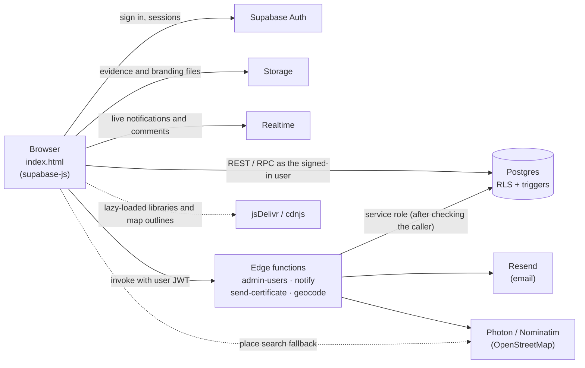
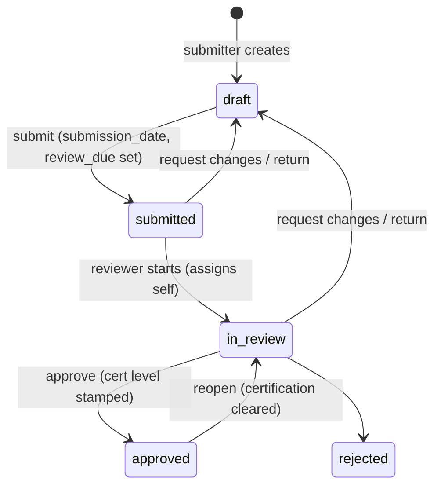

# Architecture

## Overview

There is no application server. The page is static and holds the whole UI. Business rules live in the database (RLS policies, triggers, security-definer functions), so they hold however the data is reached: the portal, the Supabase dashboard or the API.

## Security model

**Authentication.** Supabase Auth with email and password. Accounts are created three ways: self sign-up (role `submitter`), by staff (temporary password or email invite, through `admin-users`), or by delegate invitation. A trigger on `auth.users` (`private.handle_new_user`) creates the matching `profiles` row and links any pending delegate invitations.

**Authorization lives in the database.**

- Every table in `public` has RLS turned on.
- Policies call small `security definer` helpers in the `private` schema, which isn't exposed through the API:
  - `current_app_role()` returns the caller's role, or null if their account is deactivated
  - `can_view_production(pid)`, `can_edit_answers(pid)`, `is_delegate(pid)`, `is_assigned_reviewer(pid)`, `can_edit_question(pid, qid)`, `can_edit_department(pid, did)`, `can_view_contact(cid)`
- Column-level rules that RLS can't express are enforced by `BEFORE` triggers. Most of them quietly put protected columns back to their old values rather than raising an error:
  - `guard_production_submitter`: when a submitter edits, it keeps the assigned reviewer, review due date, certification fields, form version, certificate token and geo fields unchanged. RLS limits submitters to their own drafts and to the statuses `draft` and `submitted`.
  - `guard_response_scoring`: only reviewers and staff set verified points, reviewer notes and flags. When a submitter changes a flagged answer, it stamps `flag_addressed_at`.
  - `guard_profile_role`: only staff change roles or deactivate accounts
  - `guard_comment_update`: comment text can't be edited after posting

**Privileged work runs in edge functions.** Each one checks the caller's token and role before acting. Most use the service role only after that check, and read data through a client built from the caller's own token where possible, so RLS still applies (see [edge-functions.md](edge-functions.md)).

**Public data.** Only two things are readable without signing in:

- `app_settings` (theme, so the sign-in page is branded)
- the `certificate_by_token(token)` RPC, which returns certificate fields only for approved, certified applications

## Roles and what they see

| | submitter | delegate | reviewer | staff |
|---|---|---|---|---|
| Own applications | read/write while draft | — | — | — |
| Delegated departments | — | answers, answerers, evidence while draft | — | — |
| Submitted applications | read own | read | read/score/decide | everything |
| Dashboard, Analysis, Report | — | — | ✓ | ✓ |
| Questions, Admin, Design | — | — | — | ✓ |

## Application lifecycle

Triggers do the bookkeeping at each step:

| Trigger | When | What it does |
|---|---|---|
| `touch_production` | every change | `updated_at`; `submission_date` on submit |
| `set_review_due` | submit or resubmit | `review_due` = today + review target (`app_settings.review`) |
| `stamp_certification` | approve | `cert_level`, `cert_score`, `certified_at` from `private.final_score` and `private.level_for`; cleared when leaving Approved |
| `notify_status_change` | status or reviewer changes | bell notifications |
| `log_production_events`, `log_response_events`, `log_evidence_events` | edits | activity log (`application_events`), folding repeat edits within 15 minutes |
| `record_deletion` | delete | a row in `application_deletions` |

## Scoring

Each PEACH action (`questions`) has `answer_options` = `[{label, points, na}]`. The rules:

- An answer earns its option's points.
- **N/A** removes the action from the points available.
- **Innovation** actions are bonus points: they add to the points earned but not to the points available.
- **Self-assessed score** = earned ÷ available, computed separately at **prep** and at **wrap**.
- **Final score** (certification) = wrap points ÷ available. Where a reviewer entered *verified points* they are used; otherwise the points of the submitter's answer count. `private.final_score` computes it in SQL. The front end mirrors it in `peachScore` and `finalScore` for live display.
- **Level** = the highest level in `app_settings.certification.levels` whose `min` the score reaches (`private.level_for`).

## Form versions

Questions belong to a `form_version` (for example "PEACH v2.0"). Each application stores the version it started on and is always shown and scored against those questions.

- Staff start a new version with the `start_form_version` RPC, which copies the current questions under the new name.
- `app_settings.form.current` names the version new applications use.
- The dashboard, Analysis and the report cover the current version only.

## External services

| Service | Used for | Notes |
|---|---|---|
| Resend | Status emails (`notify`), certificate emails (`send-certificate`) | Needs `RESEND_API_KEY`. Until it's set, the functions skip email and say so. |
| Photon (komoot), Nominatim | Turning a production's location into city, region, country and coordinates | OpenStreetMap data; attribution is shown on maps. Nominatim blocks Supabase's servers, so Photon goes first, and the browser can search Photon itself. |
| jsDelivr / cdnjs | supabase-js, d3-geo, topojson-client, world-atlas, us-atlas, SheetJS | All pinned to exact versions. Map and Excel libraries load only when needed. |
| Google Fonts | Gloock, Jost and the alternative font pairings | |
